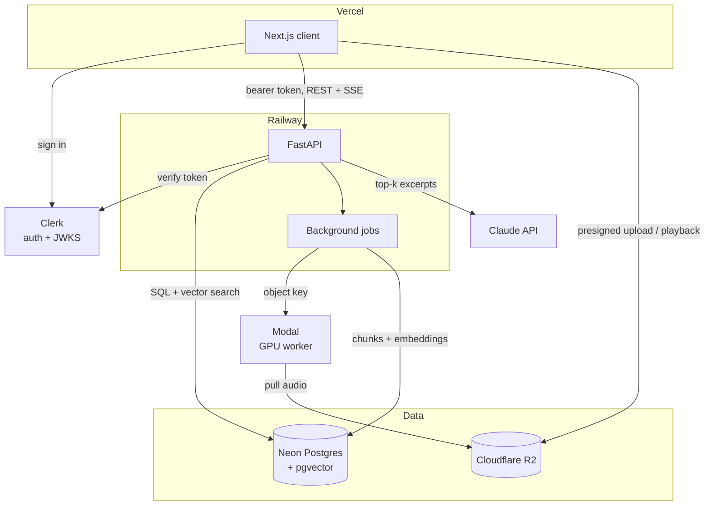

# Pumped Up Kicks

**Ask your lecture a question. Get the answer, and the exact second your professor said it.**

Upload a recorded lecture, or connect Canvas, and ask in plain English. Every claim in an answer links to a timestamp like `[12:04]`, and clicking it jumps the video there. Answers come only from your own lectures and course material. If they did not cover it, the app says so.

Beyond asking: one-click study guides for a lecture, practice questions and flashcards for a subject, a searchable transcript with click-to-seek, Canvas deadlines, and any chat saved as Markdown notes. **Your data** in the workspace downloads everything or deletes the account, Canvas access included.

## Architecture



Video never passes through the API: browser to R2 to Modal.

Ingest: upload, transcribe (faster-whisper on a Modal A10G, or local Whisper), chunk into 75 s windows with 18 s overlap, embed with fastembed (all-MiniLM-L6-v2, 384 dimensions), store in pgvector with an HNSW cosine index. A lecture moves through `queued`, `transcribing`, `indexing`, then `ready` or `failed`.

Ask: the question is embedded, the nearest chunks for that user and scope (one lecture, one subject, or everything) are retrieved, and only those excerpts go to Claude. The answer streams back over SSE with its sources and cost.

## Stack

| Layer | Technology |
|---|---|
| Client | Next.js 16, React 19, TypeScript 6, Tailwind CSS 4, Clerk |
| API | FastAPI, Pydantic v2, SQLAlchemy 2, Alembic |
| Retrieval | PostgreSQL with pgvector (HNSW), Postgres full-text search, fastembed (ONNX) |
| Transcription | faster-whisper on Modal, or local Whisper |
| Answers | Claude (model set by `PUK_CLAUDE_MODEL`), per-message cost tracking |
| Storage | Cloudflare R2 over the S3 API, or local disk |
| Hosting | Vercel, Railway, Neon, Modal |

## Quick start

Prerequisites: Python 3.12, Node 20.9 or newer, ffmpeg, PostgreSQL 17 with pgvector, and an Anthropic API key.

```bash
# Database
brew install postgresql@17 pgvector && brew services start postgresql@17
createdb kicks_dev && psql -d kicks_dev -c "create extension vector;"

# Server -> http://localhost:8000
cd server
python3 -m venv venv && source venv/bin/activate
pip install -r requirements.txt -r requirements-local.txt
cp .env.example .env            # set ANTHROPIC_API_KEY
alembic upgrade head
./start_server.sh

# Client -> http://localhost:3000
cd client
npm install
cp .env.example .env.local
npm run dev
```

The example server env sets `ENV=development` and `AUTH_MODE=dev`, so no sign-in is needed locally and API docs are served at `/docs`. Without `ENV=development` the server runs in production mode and refuses to start until `AUTH_MODE=clerk`, `CLERK_JWKS_URL`, `CLERK_ISSUER`, `ALLOWED_HOSTS` and a real `SECRET_KEY` are set.

## Tests

```bash
cd server && pip install -r requirements-dev.txt && python -m pytest tests evals   # 142 tests, needs Postgres + pgvector
cd client && npm run lint && npm run typecheck && npm run e2e                     # Playwright + axe
```

Set `TEST_DATABASE_URL` to point the server tests at a different database. They create and empty it, so never aim it at real data.

CI (`.github/workflows/ci.yml`) runs the server tests against a pgvector Postgres, `pip-audit`, client lint and build, and `npm audit --audit-level=high` on every push and pull request. Dependabot proposes dependency updates weekly.

## Repository layout

```
client/   Next.js app (see client/README.md)
server/   FastAPI app, migrations, tests, evals, Modal worker (see server/README.md)
docs/     SETUP.md, CANVAS.md, ARCHITECTURE.md, DESIGN.md
```

## Documentation

- [docs/SETUP.md](docs/SETUP.md): accounts, keys, deployment and the pre-launch checklist.
- [docs/CANVAS.md](docs/CANVAS.md): enabling Canvas for a school, and what gets imported.
- [docs/ARCHITECTURE.md](docs/ARCHITECTURE.md): design decisions, retrieval design, cost model, roadmap and risks.
- [docs/DESIGN.md](docs/DESIGN.md): the design system (navy ink on cool marble): tokens, components and accessibility rules.
- Policies, served by the client: `/privacy`, `/terms`, `/acceptable-use` (academic integrity and recording rules), `/cookies`, `/security`, and `/.well-known/security.txt`.

## Known limits

- Jobs run in FastAPI `BackgroundTasks`, so a restart loses in-flight work.
- Filtered HNSW recall can drop as the number of tenants grows.
- English only.

## Team

Sejal Hukare, Ishita Pawar, Rajvardhan Patil, Chetan Monhot
